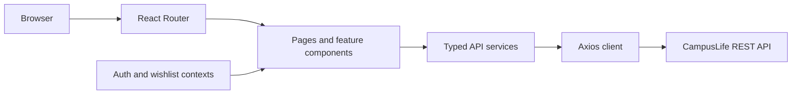
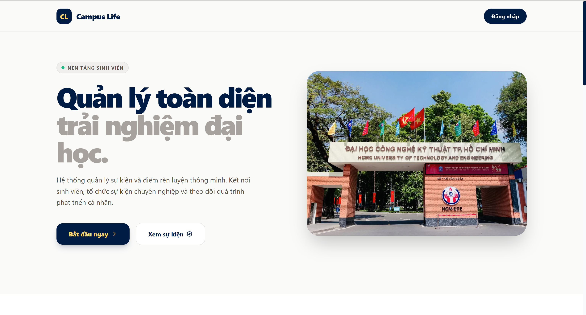
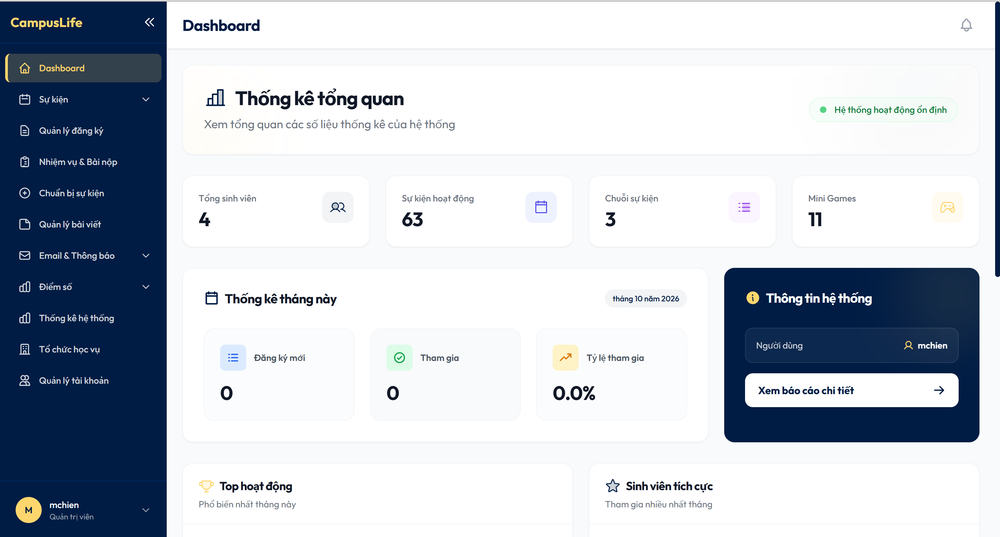
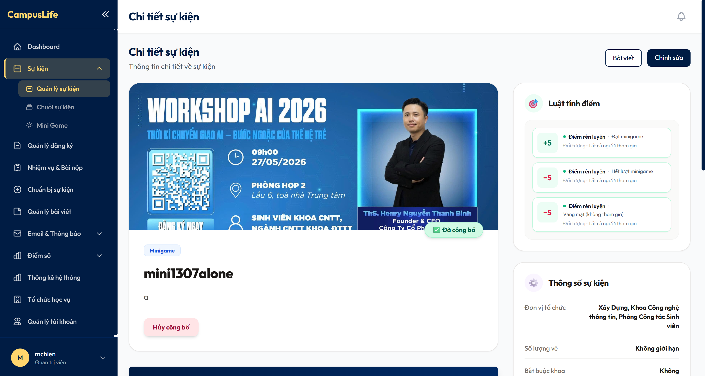
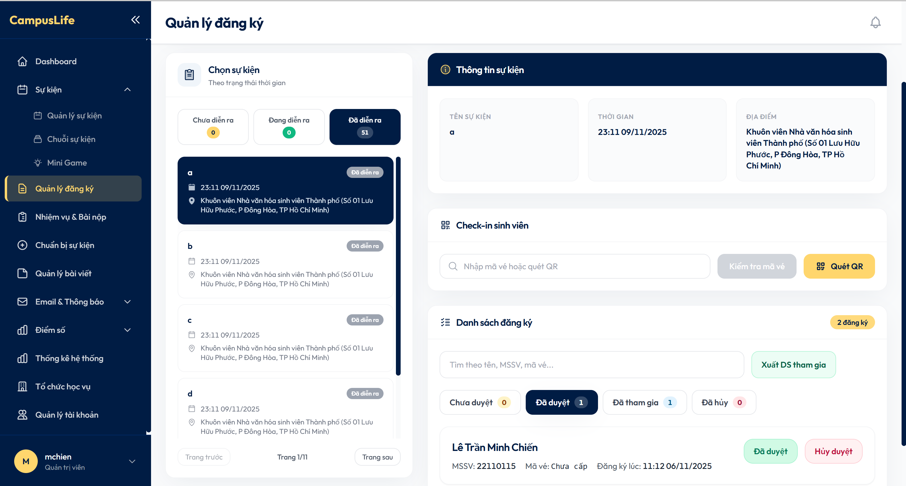
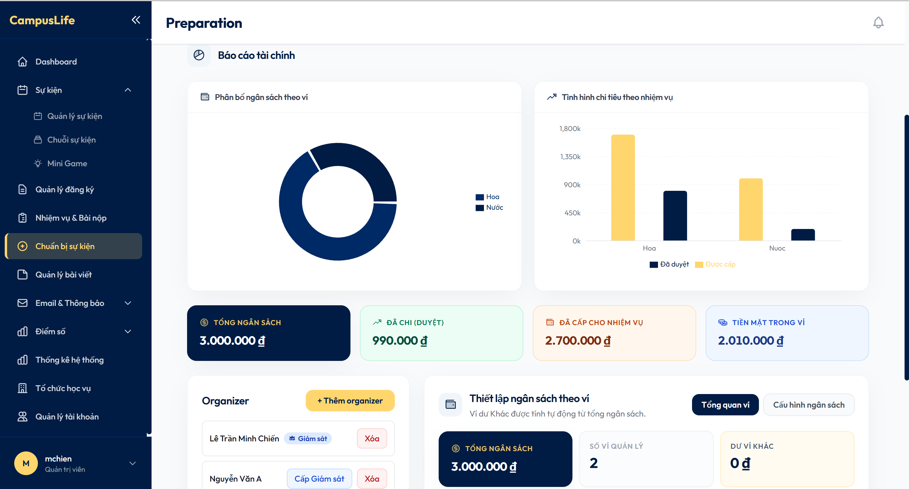
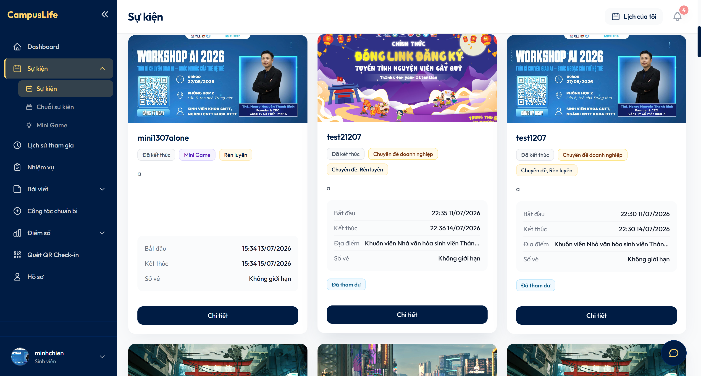
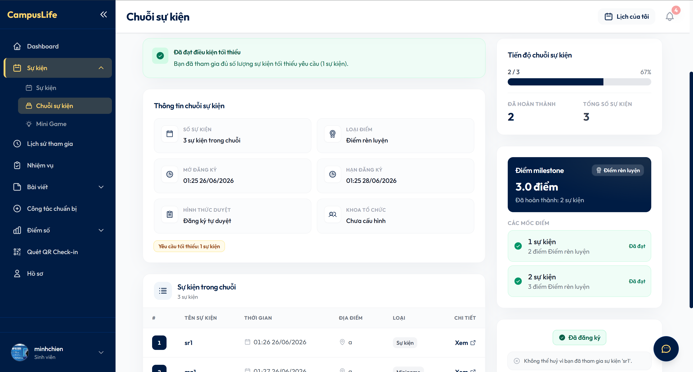
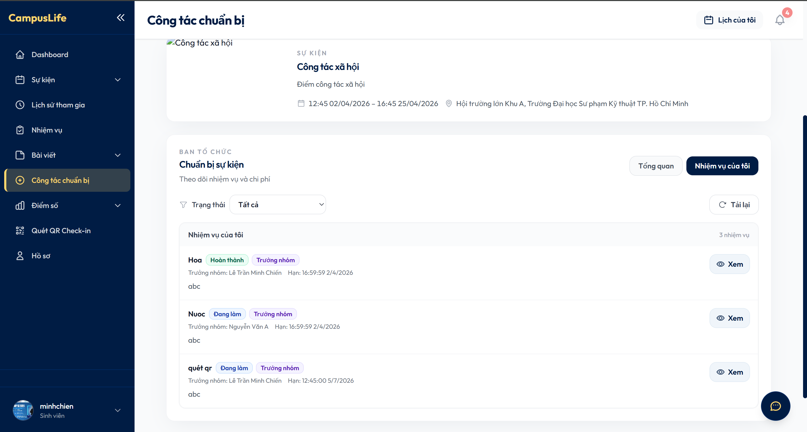
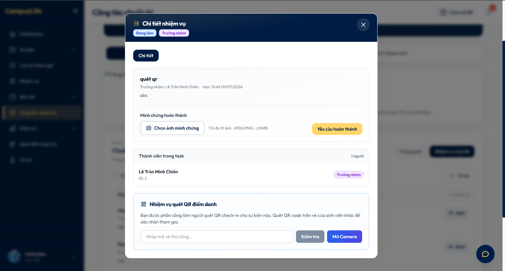

# CampusLife Web

CampusLife is a web interface for university activity management. Students can discover events, register, check in, complete tasks, and review their scores; administrators and managers can organize activities and follow participation. This repository contains the React/TypeScript client for the [CampusLife API](https://github.com/mchien04/CampusLife).

## Key features

- **Student experience:** Browse activities and articles, register for events or series, scan QR codes for attendance, submit task evidence, take quizzes, and view scores and appeals.
- **Management workflows:** Create and publish activities, configure score rules and series presets, review registrations and submissions, manage preparation tasks and finances, and inspect reports and statistics.
- **Content and communication:** Edit event articles, manage media and comments, and read in-app notifications. The interface also includes a contextual FAQ-style chatbot.

## Tech stack

| Area | Technology |
| --- | --- |
| UI | React 19, TypeScript 5.9, Tailwind CSS, Create React App (`react-scripts` 5) |
| Navigation and API | React Router 7, Axios |
| Shared and server state | React Context, TanStack React Query 5 on selected score screens |
| Feature UI | TipTap, DOMPurify, Recharts, QR code and scanner libraries |
| Tooling | npm, TypeScript typecheck, ESLint, React Testing Library |

## Architecture

`src/App.tsx` defines public and role-protected routes for students, managers, and administrators. Pages compose domain components and call typed service modules under `src/services/`. An Axios instance supplies the Backend base URL and Bearer token, while `AuthContext` manages session state and `WishlistContext` manages saved articles. React Query is used for selected score and appeal views; other pages use local React state and hooks.



The main feature areas are activities and registrations, series and mini games, tasks and preparation, scores and appeals, articles, and dashboards.

## Project structure

```text
src/
├── App.tsx          Routes and application providers
├── pages/           Student, manager, admin, and public screens
├── components/      Shared and domain-specific UI
├── services/        Backend API clients
├── contexts/        Authentication and wishlist state
├── hooks/           Reusable interface behavior
├── types/           TypeScript API and domain models
├── utils/           Formatting, validation, and file helpers
└── styles/          Shared styles and theme
public/              Static assets
docs/                Additional feature and integration notes
```

## Getting started

**Prerequisites:** Node.js 20 and npm. Start the [Backend API](https://github.com/mchien04/CampusLife) separately for data-backed features.

1. Install dependencies from this repository's root:

   ```bash
   npm ci
   ```

2. Point the client at your Backend. For local development, add or update `.env.local`:

   ```dotenv
   REACT_APP_API_BASE_URL=http://localhost:8080
   ```

3. Start the development server:

   ```bash
   npm start
   ```

   The web app opens at `http://localhost:3000`. The API client also defaults to `http://localhost:8080` if `REACT_APP_API_BASE_URL` is unset.

4. Check types, lint, or create a production build:

   ```bash
   npm run typecheck
   npm run lint
   npm run build
   ```

## Environment variables

| Variable | Purpose |
| --- | --- |
| `REACT_APP_API_BASE_URL` | Base URL of the Spring Boot API. Set it to the Railway API URL for a deployed build; local fallback is `http://localhost:8080`. |

Create React App embeds `REACT_APP_*` values at build time. Do not put private credentials in frontend environment variables.

## Backend integration

The [CampusLife Backend](https://github.com/mchien04/CampusLife) exposes JSON REST endpoints under `/api`. Service modules such as `eventAPI`, `registrationAPI`, `scoresAPI`, and `preparationAPI` keep requests separate from page components. The shared Axios client reads the token from `localStorage`, adds `Authorization: Bearer <token>`, handles multipart uploads, and redirects to login after an HTTP `401` response. Backend authorization remains the source of truth for protected operations.

## Screenshots and demo

The screenshots below show the public landing page and representative administrator and student workflows. Click an image to view it at full size.

### Landing page

[](docs/screenshots/landing-page.png)

### Administrator

| Dashboard and system overview | Event details and scoring rules |
| --- | --- |
| [](docs/screenshots/admin/dashboard.png) | [](docs/screenshots/admin/event-detail.png) |
| Registration review and check-in | Event preparation and budget |
| [](docs/screenshots/admin/registrations.png) | [](docs/screenshots/admin/event-budget.png) |

### Student

| Event catalog | Event series progress |
| --- | --- |
| [](docs/screenshots/student/events.png) | [](docs/screenshots/student/event-series.png) |
| Preparation tasks | Task details and QR check-in assignment |
| [](docs/screenshots/student/preparation-tasks.png) | [](docs/screenshots/student/task-detail.png) |

## Deployment

The frontend is deployed on Vercel. [vercel.json](vercel.json) runs `npm run build` and serves the Create React App `build/` output. Configure `REACT_APP_API_BASE_URL` in Vercel before building so the client calls the Railway-hosted Backend.

GitHub Actions [CI](.github/workflows/ci.yml) runs `npm ci`, typecheck, lint, and build for pull requests to `main` and pushes to `prod`. Vercel deployment settings are managed outside this repository; this workflow does not deploy the site.

## Related repository

- [CampusLife Spring Boot backend](https://github.com/mchien04/CampusLife)

## Author

- GitHub profile: https://github.com/mchien04
